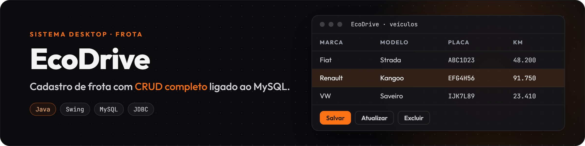
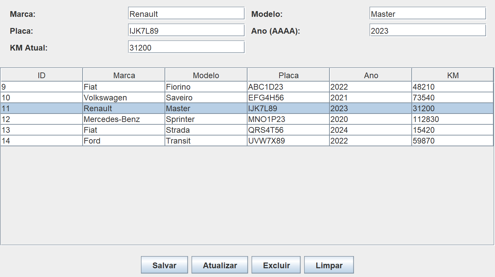

Aplicação desktop para cadastrar e acompanhar a frota de uma empresa: marca, modelo, placa, ano e quilometragem de cada veículo, com cadastro, consulta, edição e exclusão. Feito em Java com Swing, MySQL e JDBC.



*Ao selecionar um veículo na tabela, os campos são preenchidos para editar ou excluir. Veículos de exemplo.*

## O que este projeto mostra

- CRUD completo ligado a um banco MySQL via JDBC.
- Tabela da tela sincronizada com o banco.
- Placa única no banco (`UNIQUE`), para não cadastrar o mesmo veículo duas vezes.

## Contexto

Pequenas e médias empresas com frota própria costumam perder o controle de quilometragem, ano e identificação dos veículos, o que atrasa manutenções e aumenta custos. O EcoDrive centraliza esses dados numa aplicação simples, sem a complexidade de um ERP.

## Arquitetura

- **Interface (Swing):** `JFrame` com `BorderLayout` e `GridLayout`; campos `JTextField` para marca, modelo, placa, ano e KM; `JTable` com `DefaultTableModel`; um `ListSelectionListener` preenche os campos quando uma linha é selecionada.
- **Conexão (JDBC):** `mysql-connector-j` com a API `java.sql` (`Connection`, `Statement`, `ResultSet`).
- **Banco (MySQL):** banco `ecodrive_db` com a tabela `veiculos`.

## Operações

| Operação | Na tela | No banco |
| :--- | :--- | :--- |
| Salvar | Preenche os campos e clica em Salvar | `INSERT INTO veiculos (...)` |
| Listar | A tabela é recarregada após cada operação | `SELECT * FROM veiculos` |
| Atualizar | Seleciona a linha, altera os campos e clica em Atualizar | `UPDATE veiculos SET ... WHERE id = (id selecionado)` |
| Excluir | Seleciona a linha e clica em Excluir | `DELETE FROM veiculos WHERE id = (id selecionado)` |
| Limpar | Esvazia os campos para um novo cadastro | — |

## Banco de dados

O script está em `script.sql`:

```sql
CREATE DATABASE IF NOT EXISTS ecodrive_db;
USE ecodrive_db;

CREATE TABLE IF NOT EXISTS veiculos (
    id INT AUTO_INCREMENT PRIMARY KEY,
    marca VARCHAR(100) NOT NULL,
    modelo VARCHAR(100) NOT NULL,
    placa VARCHAR(20) NOT NULL UNIQUE,
    ano INT NOT NULL,
    quilometragem INT NOT NULL
);
```

## Como rodar

Pré-requisitos: JDK 17+, MySQL 8 e o driver [MySQL Connector/J](https://dev.mysql.com/downloads/connector/j/) (`.jar`).

1. Rode `script.sql` no MySQL.
2. Em `EcoDriveApp.java`, ajuste o usuário e a senha do seu MySQL nas variáveis de conexão.
3. Com o `.jar` do Connector/J na mesma pasta do `EcoDriveApp.java`:
   - Windows: `java -cp "mysql-connector-j.jar;." EcoDriveApp.java`
   - Linux/macOS: `java -cp "mysql-connector-j.jar:." EcoDriveApp.java`

## Material de apresentação

Os slides com o estudo de caso estão em `EcoDrive Apresentacao.pdf`.

## Próximos passos

- [ ] Separar o código em camadas (`model`, `dao`, `ui`), como no RH Folha e no Clínica Vida
- [ ] Ler a conexão de um arquivo de configuração fora do Git, em vez de deixar no código
- [ ] Registro de manutenções e alerta por quilometragem
